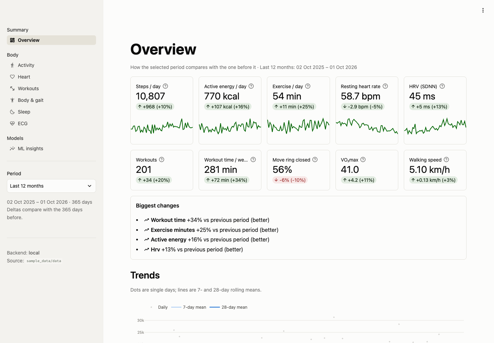
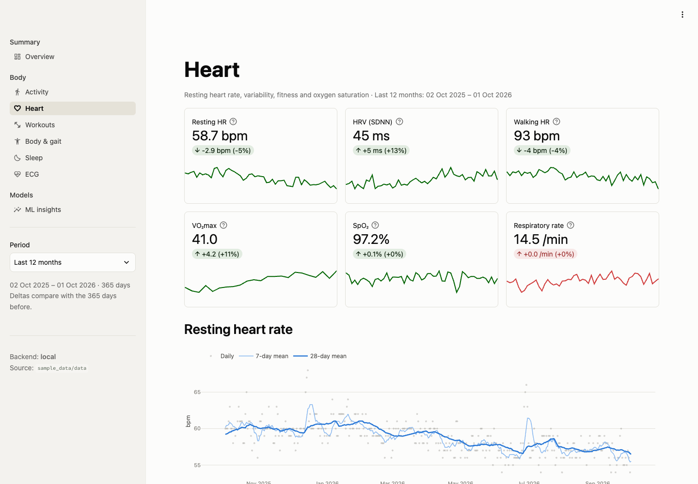
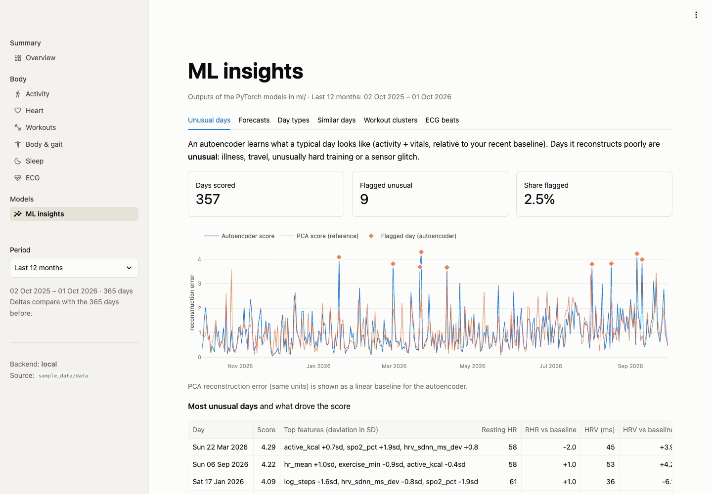
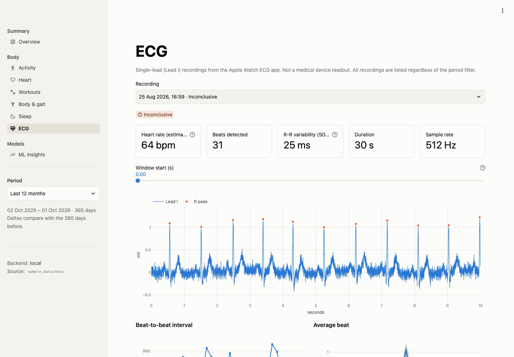
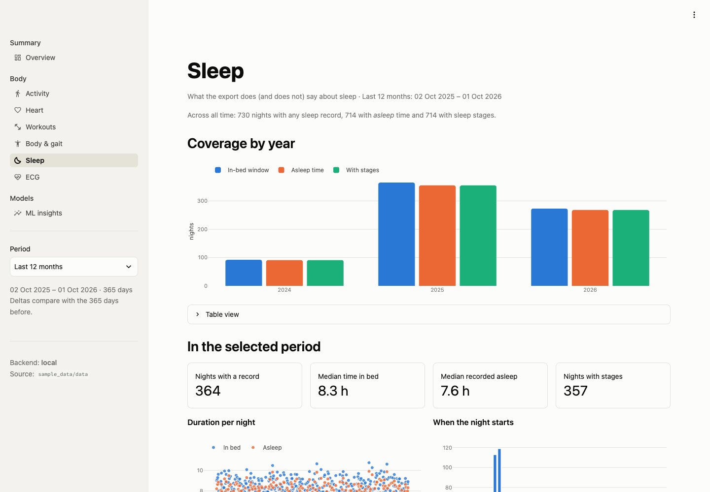
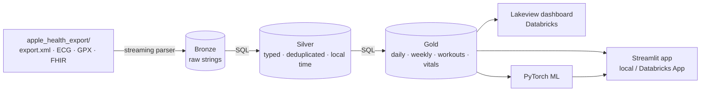

<div align="center">

# Apple Health Data Pipeline

**Turn your Apple Health export into a private health lakehouse, with an app, a dashboard and machine
learning on top.**

Runs on your laptop in minutes. Scales to Databricks with one command.

[](https://github.com/messeb/py-apple-health-data-pipeline/actions/workflows/ci.yml)
[](LICENSE)


[Getting Started](docs/getting-started.md) ·
[Streamlit App](docs/app.md) ·
[Machine Learning](docs/ml.md) ·
[Databricks Step by Step](docs/databricks.md) ·
[Data Model](docs/data-model.md) ·
[Privacy](docs/privacy.md)

</div>



<table>
  <tr>
    <td></td>
    <td></td>
  </tr>
  <tr>
    <td></td>
    <td></td>
  </tr>
</table>

<sub>All screenshots show the synthetic demo data from <code>make demo</code>.</sub>

---

Your iPhone and Apple Watch quietly collect years of steps, heart rate, HRV, workouts, GPS routes and ECGs.
The Health app shows you a few charts. The export gives you everything, as a single multi-gigabyte XML
file that's hard to use.

**This project turns that file into clean, queryable tables:**

- bronze → silver → gold;
- an interactive Streamlit app and a Databricks Lakeview dashboard on top;
- PyTorch models that forecast, find unusual days and spot patterns in your habits.

Your data never leaves your machine, or your own Databricks workspace if you choose to use one.

## What This Project Demonstrates

It is a complete, small-scale data platform built around one very personal dataset. Each part is a
pattern you'd use at work:

| Topic | How it shows up here |
|---|---|
| **Data engineering** | Medallion architecture (bronze → silver → gold), a streaming XML parser for multi-GB files, lineage columns, data-quality checks as code |
| **SQL that runs anywhere** | One set of Databricks SQL files, executed on DuckDB locally and on Spark/Photon in the cloud |
| **Lakehouse platform** | Databricks Asset Bundle: Unity Catalog, serverless jobs, a Lakeview (AI/BI) dashboard and a Databricks App, deployed with one command |
| **Analytics apps** | A Streamlit app with 8 pages that runs on local Parquet or on a SQL warehouse |
| **Machine learning** | PyTorch forecasting (linear → GRU/LSTM → Transformer → a zero-shot foundation model), autoencoders, clustering, ECG beat analysis, MLflow tracking, honest baselines |
| **Software practice** | Synthetic test data, 200+ tests, CI on Python 3.11, ruff, pre-commit, a privacy guard, documentation for users and contributors |

## Scope

- **Fast parsing of multi-gigabyte `export.xml`.** A streaming parser keeps memory flat and also
  reads ECGs, GPS routes and clinical records.
- **Correct by design:**
  - real local time across daylight saving: Apple stamps every timestamp with the offset at export
    time, and the pipeline corrects it;
  - iPhone/Watch deduplication;
  - unit fixes;
  - locale-aware ECG parsing.
- **One SQL codebase, two engines.** The transformations are plain Databricks SQL files. They run on
  **DuckDB** locally and unchanged on **Spark**.
- **An app and a dashboard.**
  - **Streamlit app** with 8 pages: overview, activity, heart, workouts with route maps, body and
    gait, sleep, ECG viewer, ML insights. It runs locally or as a **Databricks App**.
  - **Lakeview dashboard** with 5 pages, native in Databricks and deployed by the bundle.
- **ML that answers real questions.**
  - Next-day resting HR / HRV forecasts, from linear regression to GRU/LSTM, Transformer and a
    pretrained foundation model, always against simple baselines.
  - Unusual days and illness-like days, similar days, day and workout types.
  - ECG beat anomalies with a 1D-CNN autoencoder, and workout effort models.
- **Private by default.**
  - No telemetry.
  - Personal identifiers are dropped at ingestion.
  - A pre-commit guard stops health data from reaching git.
  - A synthetic data generator for demos, tests and bug reports.

## Quickstart

You need [uv](https://docs.astral.sh/uv/) and your Health export. On the iPhone, export it from
*Health → profile picture → Export All Health Data*, then unzip it.

```bash
git clone https://github.com/messeb/py-apple-health-data-pipeline.git && cd py-apple-health-data-pipeline
make setup                                   # Python env + all dependencies

mv ~/Downloads/apple_health_export .         # your unzipped export
make pipeline                                # bronze → silver → gold (~1 min per 3 GB)
make app                                     # Streamlit app on http://localhost:8501
make ml                                      # optional: forecasts, anomalies, clusters
```

No export at hand? `make demo` builds everything from a realistic **synthetic** person, so you can look
around first.

**[Getting Started](docs/getting-started.md)** has every step, the CLI options and how to query the
tables with DuckDB.

## How It Works



| Layer | What it holds | Example tables |
|---|---|---|
| **Bronze** | A raw, lossless copy of every file in the export | `bronze_records`, `bronze_workouts`, `bronze_ecg_samples` |
| **Silver** | Typed values, true local time, units fixed, duplicates removed | `silver_records`, `silver_workouts`, `silver_sleep_segments` |
| **Gold** | Analysis-ready facts | `gold_daily_summary` (one wide row per day), `gold_workouts`, `gold_hourly_heart_rate` |

More in [Architecture](docs/architecture.md) and the [Data Model](docs/data-model.md).

## Take It to Databricks

The repository is a **Databricks Asset Bundle**. With the CLI logged in:

```bash
databricks bundle deploy -t dev                  # job, Lakeview dashboard, app (code only, no data)
databricks schemas create health workspace
databricks volumes create workspace health raw MANAGED
databricks fs cp -r apple_health_export dbfs:/Volumes/workspace/health/raw/apple_health_export
databricks bundle run -t dev health_pipeline     # bronze → silver → gold → quality → ML
databricks bundle run -t dev health_app          # start the Streamlit app
```

This gives you Delta tables in the `workspace.health` schema, data-quality checks, MLflow-tracked
models, a Lakeview dashboard and the Streamlit app as a Databricks App, all on serverless compute.

> **Built and tested on [Databricks Free Edition](https://www.databricks.com/learn/free-edition).**
> The whole project (job, ML tasks, Lakeview dashboard and Databricks App) runs there without a paid
> workspace.

**[Databricks Step by Step](docs/databricks.md)** covers each step with checks, costs and clean-up.

## Documentation

| Guide | What's in it |
|---|---|
| [Getting Started](docs/getting-started.md) | Export from the iPhone, install, run locally, demo mode |
| [Streamlit App](docs/app.md) | The pages, configuration, how it runs locally and as a Databricks App |
| [Machine Learning](docs/ml.md) | The seven experiments: methods, what they detect, guardrails |
| [Databricks Step by Step](docs/databricks.md) | From an empty workspace to a running pipeline, Lakeview dashboard and app |
| [Architecture](docs/architecture.md) | Design decisions: streaming parser, one SQL codebase, timezone, dedup |
| [Data Model](docs/data-model.md) | Every bronze, silver, gold and ML table |
| [Privacy](docs/privacy.md) | What stays local, what's dropped, recommendations |
| [Troubleshooting](docs/troubleshooting.md) | Common errors locally and on Databricks |

## Contributing

Contributions are welcome: new metrics, charts, models, and support for more export quirks.

- Read [CONTRIBUTING](CONTRIBUTING.md) first.
- `make demo` gives you synthetic data to develop and test against.
- `make test` runs the suite.
- Please **never attach real health data** to issues or pull requests.

Help: [SUPPORT](SUPPORT.md) · Community rules: [Code of Conduct](CODE_OF_CONDUCT.md) ·
Security: [SECURITY](SECURITY.md)

## Disclaimer

This is a personal analytics project, **not a medical device**. Forecasts, anomaly flags and ECG beat
scores are exploratory and can be wrong. Talk to a clinician about anything health-related.

This is an independent open-source project, not affiliated with or endorsed by Apple Inc. or
Databricks, Inc. "Apple Health", "Apple Watch" and "iPhone" are trademarks of Apple Inc.

## License

[MIT](LICENSE)
