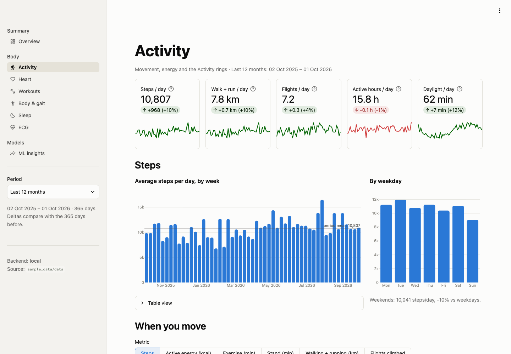

# Streamlit App


An interactive Streamlit app over the gold (and some silver) tables and the ML outputs. The same
code runs locally against Parquet files and as a **Databricks App** against a SQL warehouse; only
environment variables differ.

It is not the same as the **Lakeview dashboard** (`databricks/dashboards/health.lvdash.json`), which is
a native Databricks dashboard with 5 pages and no code. See
[Databricks Step 9](databricks.md#step-9-open-the-lakeview-dashboard).

| Page | What it answers |
|---|---|
| Overview | KPI tiles for the selected period vs the previous period of equal length, the biggest changes in words, 7/28-day trends, year-by-year bars, data coverage per metric and year |
| Activity | steps per week and weekday, an hour × weekday heatmap (steps, energy, exercise, stand, distance, flights), distance per month, energy vs move goal, ring closure rates |
| Heart | resting HR, HRV, VO₂max, hourly HR heatmap, next-day resting HR by step quintile, SpO₂ distribution |
| Workouts | volume by activity and month, HR-zone proxy, duration vs HR, a full table, a GPS route map with elevation profile |
| Body & gait | weigh-ins against all-time context, walking speed, step length, asymmetry, double support, steadiness |
| Sleep | a coverage audit first (sleep data is often sparse), then durations, bedtimes and stages |
| ECG | a waveform viewer with R-peak detection, R-R intervals, the average beat, and all recordings |
| ML insights | unusual days and episodes, forecasts with a leaderboard, day types, similar days, workout clusters, ECG beat scores, plus a generic preview of any other `data/ml/*.parquet` |

The period filter in the sidebar applies to every page. The ECG page and the
all-time sections are the exceptions, and they say so.

## Layout

| Activity | Heart | Sleep |
|---|---|---|
|  |  |  |
| **ECG** | **ML insights** | |
|  |  | |

```
app/
  app.py               entry point: navigation, sidebar period filter
  data.py              data access, both backends, every SQL query
  charts.py            palette (light + dark), Plotly styling helpers
  ui.py                period handling, KPI tiles, empty states
  views/*.py           one file per page
  .streamlit/config.toml   theme (light + dark), matches charts.py
  app.yaml             Databricks App definition
  requirements.txt     Databricks App runtime dependencies
```

## Run Locally

Build the lakehouse first (`data/silver`, `data/gold`; `data/ml` is optional), then from the repo root:

```bash
make app        # = .venv/bin/streamlit run app/app.py
```

Open http://localhost:8501. The local backend uses an in-memory DuckDB over
`data/{silver,gold,ml}/*.parquet`. It never opens `data/health.duckdb`, so the
pipeline can rebuild that file while the dashboard is running.

| Variable | Default | Meaning |
|---|---|---|
| `HEALTH_BACKEND` | `local` | `local` or `databricks` |
| `HEALTH_DATA_DIR` | `<repo>/data` | root holding `silver/`, `gold/`, `ml/` (local backend) |
| `HEALTH_CATALOG` / `HEALTH_SCHEMA` | `workspace` / `health` | where the tables live (Databricks backend) |
| `DATABRICKS_WAREHOUSE_ID` | | SQL warehouse ID (Databricks backend) |

Streamlit reads its theme from `.streamlit/config.toml` in the *current working
directory*. The repo root has a symlink `.streamlit/config.toml ->
app/.streamlit/config.toml`, so the theme applies whether you start the
app from the repo root or from `app/`.

New ML outputs show up on the ML page without code changes. Known tables get
dedicated views, and unknown ones appear under "Other tables". Query results are
cached for an hour and ML tables for a minute. Restart the server after
rebuilding gold.

Tests (data layer, Databricks SQL parsing, every page through `AppTest`, and a
real server health check):

```bash
.venv/bin/pytest tests/test_app.py
```

### Optional: Local Run Against Databricks

With a Databricks CLI profile configured (`databricks auth login`),
`databricks.sdk.core.Config()` picks it up:

```bash
HEALTH_BACKEND=databricks DATABRICKS_WAREHOUSE_ID=<id> DATABRICKS_CONFIG_PROFILE=<profile> \
  .venv/bin/streamlit run app/app.py
```

## Run as a Databricks App

The bundle deploys the app as `health-app`. Follow
[Databricks Step 10](databricks.md#step-10-start-the-streamlit-app) (start it) and
[Step 11](databricks.md#step-11-give-the-app-read-access-to-your-tables) (grant its service principal
read access). If your catalog or schema differ from `workspace` / `health`, change `HEALTH_CATALOG` /
`HEALTH_SCHEMA` in `app/app.yaml`.

### How It Works There

- `app.yaml` starts `streamlit run app.py`. Databricks Apps supplies the port
  and address (`STREAMLIT_SERVER_PORT`/`STREAMLIT_SERVER_ADDRESS` from
  `DATABRICKS_APP_PORT`), and the `.streamlit/config.toml` theme is deployed
  with the source.
- `data.py` authenticates with `databricks.sdk.core.Config()`, which reads the
  `DATABRICKS_HOST` / `DATABRICKS_CLIENT_ID` / `DATABRICKS_CLIENT_SECRET` that
  the platform injects. It connects with
  `databricks.sql.connect(server_hostname=cfg.host,
  http_path=f"/sql/1.0/warehouses/{DATABRICKS_WAREHOUSE_ID}",
  credentials_provider=lambda: cfg.authenticate)`.
- Both backends send the same SQL strings. `table()` resolves names to
  `catalog.schema.table` on Databricks and to view names locally. ML tables are
  found with `SHOW TABLES IN <catalog>.<schema> LIKE 'ml_*'`.
- The route map loads OpenStreetMap tiles in the viewer's browser. It needs no
  token and no egress from the app.

## Known Limitations

- Sleep data is often sparse (no watch at night), so the Sleep page shows its coverage first.
- The HR-zone chart is a proxy. Each workout's whole duration goes to the zone
  of its *average* HR, relative to the 98th percentile of all workout maxima.
- ECG R-peak detection is a simple threshold detector, meant for display. It is
  not a diagnosis.
