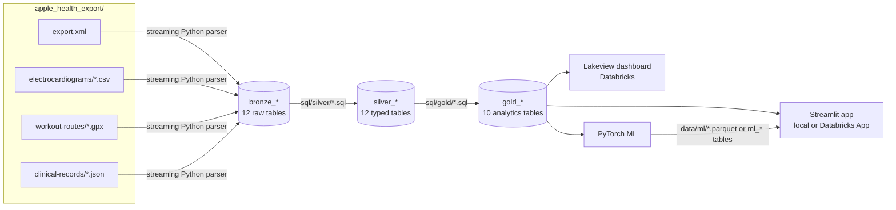

# Architecture

The pipeline follows the **medallion** pattern:

- **bronze** keeps the raw export;
- **silver** cleans and types it;
- **gold** shapes it for analysis.

The same transformation code runs on your laptop and on Databricks.

## Design Decisions

### One Parser, Any Size

`export.xml` is a single XML document, often several gigabytes. Spark can't split it, and loading it into
memory doesn't scale. The bronze parser (`src/health_lakehouse/bronze/`) streams it with
`lxml.iterparse`:

- each element is freed as soon as it has been written to Parquet;
- memory stays flat, at roughly 1 minute per 3 GB;
- on Databricks the same code runs on the driver.

Bronze keeps every attribute as a **raw string** and adds lineage columns (`_source_file`, `_ingested_at`).
Nothing is interpreted yet, so a parser bug can never silently corrupt values.

### SQL Files Are the Single Source of Truth

Each silver and gold table is one `SELECT` in `src/health_lakehouse/sql/{silver,gold}/<table>.sql`, written
in **Databricks SQL**. `pipeline.py` holds the ordered manifest of the tables.

| Environment | Engine | How the SQL runs |
|---|---|---|
| Laptop | DuckDB | Transpiled by [sqlglot](https://github.com/tobymao/sqlglot), plus a few macros where Spark semantics differ (`sql_compat.py`) |
| Databricks | Spark / Photon | Unchanged: `CREATE OR REPLACE TABLE … AS <file>` (`spark_runner.py`) |

An optional local test (`make test-spark`, needs Java) runs the same SQL files on local Spark + Delta
with ANSI mode on, as on Databricks serverless.

### Correct Local Time

Apple stamps **every** timestamp with the UTC offset in effect at *export* time. A winter workout exported
in summer therefore carries `+0200` instead of `+0100`. Silver handles this in two steps:

1. It parses the wall-clock time and offset, and converts them to a true UTC instant (`*_utc`).
2. It converts that instant to your IANA timezone (`*_local`, `local_date`, `local_hour`).

The timezone is detected from the export's `HKTimeZone` metadata, or set by you. As a result, daily totals
and hour-of-day patterns are correct across daylight saving time.

### Deduplicating iPhone + Apple Watch

The iPhone and the Watch both count steps and distance, often at the same time, so summing all sources
double counts. `gold_hourly_activity` takes the source with the largest total per hour and metric, which
approximates how the Health app deduplicates. Sleep is handled the same way, per night and stage.

### Data Quality as Code

`src/health_lakehouse/quality.py` defines a few dozen checks: row counts, unique keys, date ranges,
plausibility ranges. On Databricks they run as a job task that fails the pipeline on errors and appends
to the `data_quality_results` table.

### One App, Two Backends

The Streamlit app reads Parquet through in-memory DuckDB locally, and a Databricks SQL warehouse when it
runs as a Databricks App. The query strings are the same for both backends. See [Streamlit App](app.md).

## Repository Layout

| Path | Content |
|---|---|
| `src/health_lakehouse/bronze/` | Streaming parsers: export.xml, ECG CSV (both decimal-comma and decimal-point locales), GPX, FHIR |
| `src/health_lakehouse/sql/` | Silver and gold SQL, the single source of truth |
| `src/health_lakehouse/pipeline.py` | Layer manifest and the local DuckDB runner |
| `src/health_lakehouse/sql_compat.py` | Databricks SQL → DuckDB compatibility layer |
| `src/health_lakehouse/spark_runner.py`, `quality.py` | Spark runner with table and column comments; data-quality checks |
| `src/health_lakehouse/sample.py` | Synthetic export generator (demo, tests, CI) |
| `src/health_lakehouse/cli.py` | `health-pipeline` / `health-lakehouse` command line |
| `databricks.yml`, `databricks/notebooks/`, `databricks/dashboards/` | Databricks Asset Bundle: pipeline job, ML tasks, Lakeview dashboard, app |
| `app/` | Streamlit app (local and Databricks App) |
| `ml/` | PyTorch suite (`healthml`) and `run_all.py` |
| `tests/` | Parser, SQL compat, Spark parity, app, Lakeview dashboard, ML, bundle schema, privacy guard |
| `scripts/` | Spark validation, local notebook runner, privacy guard |
